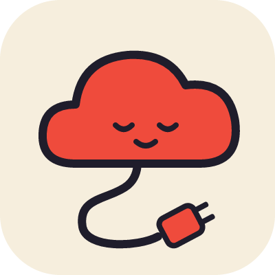
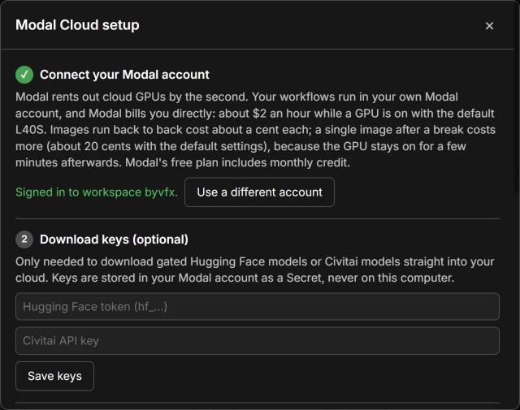
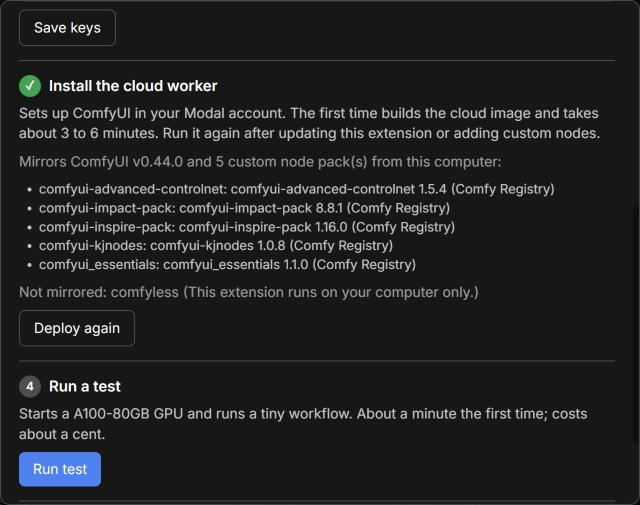
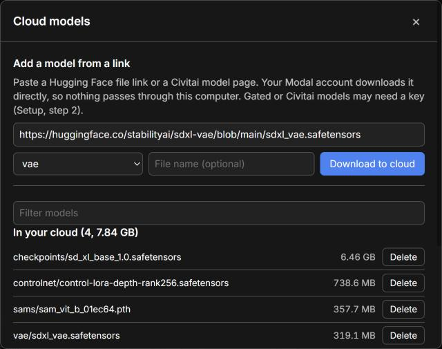
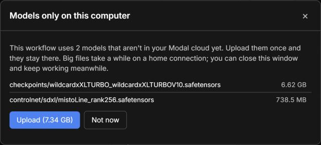
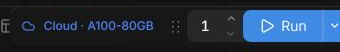
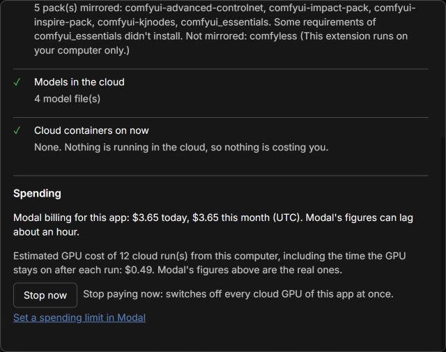

# Comfyless

**Run your ComfyUI workflows on a cloud GPU, from the ComfyUI you already use.**

Comfyless adds a **Local / Cloud** switch next to ComfyUI's Run button. With Cloud on, your workflow runs on a fast GPU (L40S, A100 or H100) in your own [Modal](https://modal.com) account, and the results appear in ComfyUI as if they ran on your computer. No server to manage, no terminal, and nothing runs (or costs) while you're not generating.

> This repository is a mirror of the `comfyless/` folder in [byvfx/comfy-serverless](https://github.com/byvfx/comfy-serverless), where development, the design spec and issues live. Please open issues and pull requests there.

## Quickstart

You need ComfyUI (0.44 or newer) and about 10 minutes. A Modal account is free to create.

### 1. Install

In ComfyUI, open **Manager → Custom Nodes Manager**, search for **Comfyless**, click **Install**, and restart ComfyUI.

If the search finds nothing (new versions wait for a Comfy Registry review), use **Manager → Install via Git URL** with `https://github.com/byvfx/comfyless` instead, then restart.

### 2. Set up

After the restart, the **Modal Cloud setup** window opens by itself. You can reopen it any time from **Extensions → Modal Cloud → Setup**.

1. **Connect your Modal account.** Click **Sign in to Modal** and approve the sign-in in the browser tab that opens. If Modal asks for a code, it's shown in the window. No account yet? Use the **Sign up free** link first.
2. **Download keys (optional).** A Hugging Face token or a Civitai API key. You only need them for gated Hugging Face models or Civitai downloads. They're stored in your Modal account, never on your computer.

3. **Install the cloud worker.** Click **Deploy**. This sets up ComfyUI in your Modal account and copies your custom node packs. The first time takes 3 to 6 minutes, with the progress shown in the window.
4. **Run a test.** This starts a cloud GPU and runs a tiny workflow. It takes about a minute, and the run itself costs a few cents. Afterwards the GPU stays on for the **Keep GPU warm for** time (5 minutes by default, about 16 cents on the L40S). If you're not going to run anything soon, click **Stop now** in *Check setup* to switch it off.

Then set a monthly spending limit in Modal's dashboard ([how](https://modal.com/docs/guide/budgets)) and click **Finish**.

### 3. Add models

Your cloud has its own model storage, separate from your computer. Open **Extensions → Modal Cloud → Cloud models**:

- **Add from a link:** paste a Hugging Face file link or a Civitai model page, pick the folder (checkpoints, loras, vae, ...), and click **Download to cloud**. Modal downloads it directly, so it's fast and doesn't use your internet connection. You don't need a copy on your computer.
- **Upload:** in the **Only on this computer** list, click **Upload** next to a model you already have. This uses your own connection, so big checkpoints take a while.
- **Delete** removes a model from the cloud (click twice to confirm). A copy on your computer stays.

Cloud models appear in ComfyUI's model lists as soon as a transfer finishes.

If you skip this step, a workflow that needs a model the cloud doesn't have stops before anything is sent, and offers to upload just those models:

### 4. Run

Click **Local** next to the Run button so it says **Cloud**, then press **Run** as usual.

Progress, errors and images show in ComfyUI as normal, and outputs are saved to your local `output/` folder. Input images are uploaded automatically, and Cancel works as usual. Each finished run shows roughly what it cost.

Choose the GPU in **Settings → Modal Cloud**:
- **L40S** (default): good for most image work.
- **A100-80GB** or **H100**: for big video models, or anything that runs out of memory. The H100 is about twice the price and faster.

The same page sets **Keep GPU warm for**: how long the GPU stays on after a run.

## What it costs

You pay Modal directly, by the second, only while a cloud GPU is on. Measured with SDXL (1024×1024, 30 steps):

- **L40S (default):** about $1.95 an hour while on. A warm image takes about 5 seconds, roughly a cent.
- **Starting a GPU** after a break takes 30 to 45 seconds.
- **After a run, the GPU stays on** for a few minutes (5 by default, adjustable) so your next run starts instantly. That idle time is billed too and is usually most of the cost of a single image: one image on its own costs about 20 cents with the 5-minute default, or about 7 cents with 1 minute. Ten images in a row cost about a cent each.

Modal's free plan includes monthly credit. **Extensions → Modal Cloud → Check setup and spending** shows what Modal billed this app today and this month, and whether any cloud GPU is on right now:

## How to stop paying

- **Right now:** click **Stop now** in *Check setup*, or use **Extensions → Modal Cloud → Stop cloud GPUs now**. This cancels running cloud jobs **and cloud model downloads**, and switches every cloud GPU off at once, instead of waiting out the idle time. A cancelled download has to be started again. Your deployed cloud worker and the models already in your cloud stay as they are, and your next run starts the GPU again.
- **Day to day:** nothing to do. GPUs switch off by themselves after the **Keep GPU warm for** time. A shorter time costs less per image, and a longer one makes back-to-back runs faster.
- **For good:** in the [Modal dashboard](https://modal.com/apps), stop the app `comfy-modal-bridge`. Then, under **Storage**, delete the volumes `comfy-models` (your cloud models) and `comfy-io`. Uninstall Comfyless from ComfyUI-Manager if you no longer want the switch.

## How to update

1. In **Manager → Custom Nodes Manager**, update **Comfyless** and restart ComfyUI.
2. Open **Extensions → Modal Cloud → Setup** and click **Deploy again**. *Check setup* also tells you when the cloud needs it.

Deploy again after adding or updating custom node packs too.

## Custom nodes

Your packs in `custom_nodes/` are mirrored to the cloud when you deploy:
- Packs from the Comfy Registry or git are installed at the same version; others are uploaded from your computer.
- Packs that don't install in the cloud are listed in the deploy log and in *Check setup*.
- A workflow that needs one of them is stopped before it runs, with the node highlighted.

## Troubleshooting

| You see | What to do |
|---|---|
| "Not signed in to Modal, or the sign-in has expired" | Open **Setup** and click **Sign in to Modal** (shown as **Use a different account** if you were signed in before) and approve the sign-in again. |
| "Can't reach your Modal app" or "The cloud backend isn't deployed" | Open **Setup** and click **Deploy**. |
| "Some models are only on this computer" | Click **Upload** in the window that opens, or add the model in **Cloud models**. |
| "Some nodes aren't available in the cloud" | **Deploy again**. If the node's pack failed to install, *Check setup* says why; run that workflow locally for now. |
| "The cloud GPU ran out of memory" | Pick **A100-80GB** or **H100** in **Settings → Modal Cloud**, or lower the resolution or batch size. |
| "Modal has no free GPUs of this type right now" | Try again in a moment, or pick another GPU. |
| "...billing or spending limit" | Check your Modal billing page; you may have hit your spending limit. |
| A download says it was refused (401/403) | The model needs a key (**Setup**, step 2), or you need to accept its license on the model's page first. |
| "That link opened a web page, not a file" | Use the file's download link. On Hugging Face, open the file in the **Files** tab and copy the link from there. |
| The first run after a break is slow | Starting a GPU takes 30 to 45 seconds. Later runs are fast while it stays warm. |
| Anything else | Open **Check setup and spending**: each row says what's wrong and how to fix it. |

Limitations for now: cloud jobs don't appear in the queue panel, and packs that need system software the cloud doesn't have may not install.

## Privacy and security

- Your workflows, images and models stay in your own Modal account.
- Your Modal sign-in is stored where Modal's own tools keep it (`~/.modal.toml`), and download keys only in your Modal account.
- Setup can only be changed from the computer running ComfyUI.

## License

GPL-3.0, the same as ComfyUI. See [LICENSE](LICENSE).
